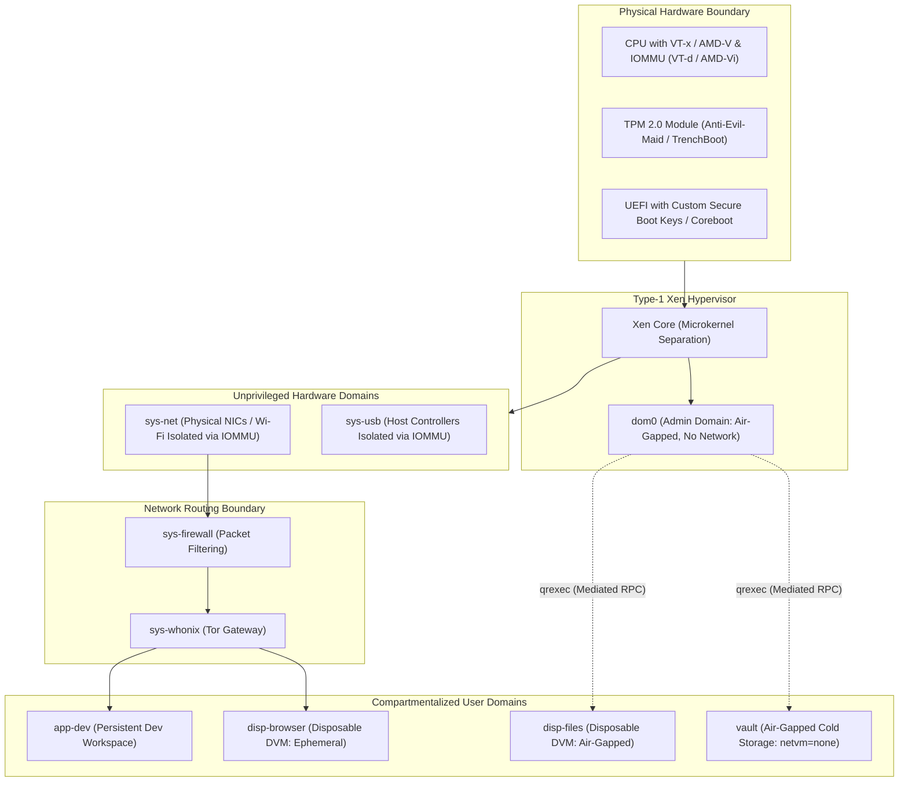

# AMNESIAX — Production Bare-Metal Deployment & Hardening Guide
**Target Platform:** Qubes OS 4.2+ (Xen Hypervisor Type-1 Bare-Metal)  
**Security Classification:** Compartmentalized High-Assurance Workstation  

---

## 1. Phase 1: Hardware Selection & Bare-Metal Audit

Production deployment shifts the root of trust from a host OS kernel to **physical hardware, CPU virtualization extensions, and the Xen Type-1 hypervisor**.



### 1.1 Hardware Prerequisites Checklist
* **IOMMU / DMA Protection:** Processor and motherboard **must** support Intel VT-d or AMD-Vi with isolated PCI interrupt remapping. This enables Xen to assign physical PCI devices (Wi-Fi, Ethernet, USB) to unprivileged qubes (`sys-net`, `sys-usb`) without giving those drivers direct DMA access to host RAM.
* **SLAT / EPT:** Second Level Address Translation (Extended Page Tables) for hardware-enforced memory virtualization.
* **TPM 2.0:** Required for Measured Boot / Anti-Evil-Maid (AEM) to detect physical boot tamper attacks.
* **Physical Device Pre-flight Check (Qubes HCL):**
  Run from a Qubes live environment before full installation:
  ```bash
  qubes-hcl-report
  ```
  Verify that:
  - `HVM: Active`
  - `I/O MMU: Active`
  - `TPM: Device present (Version 2.0)`

---

## 2. Phase 2: Translating Prototype Architecture to Native Qubes

In Qubes OS, prototype bash scripts (`setup_gateway.sh`, `nftables.conf`) are replaced by **native system domains and qrexec policy files**.

| Prototype Mechanism | Production Qubes OS Native Replacement | Defensive Benefit |
| :--- | :--- | :--- |
| **`gateway/setup_gateway.sh`** | **`sys-whonix` / `sys-firewall`** | Maintained Whonix Tor gateway template; upstream security audits; non-bypassable virtual interfaces. |
| **Fail-Closed Forwarding Drop** | **`netvm` attribute separation** | App qubes are physically incapable of reaching WAN; routing only exists over Xen virtual channels to `sys-whonix`. |
| **Ephemeral Session Discard** | **Disposable VM Templates (`disp-amnesiax`)** | Root and user filesystem layers exist strictly in volatile RAM/ephemeral overlays; wiped upon process exit. |
| **Direct Egress Denial** | **Air-gapped `vault` (`netvm = none`)** | The kernel in `vault` is provisioned with zero virtual network adapters. |
| **Boundary Control** | **`qrexec` policy (`/etc/qubes/policy.d/`)** | Zero inter-VM communication without explicit cryptographic challenge and user confirmation prompt. |

---

## 3. Phase 3: Production Acceptance Matrix

| Acceptance Check | Test Method | Pass Criteria |
| :--- | :--- | :--- |
| **1. Hardware IOMMU Isolation** | `xl pci-assignable-list` in dom0 | Network and USB controllers are listed as assignable and bound only to `sys-net` and `sys-usb`. |
| **2. Air-Gapped Vault Integrity** | `qvm-check --property vault netvm` | Returns `none`. `ip link` inside `vault` shows only `lo`. |
| **3. Hardware Link Pull (Fail-Closed)** | Physically disconnect Ethernet / toggle Wi-Fi radio kill switch. | App qubes drop active connections immediately; no retry packet loops leak to local adapters. |
| **4. Disposable Ephemeral Wipe** | Create file in `disp-browser`, close browser window, inspect backing volume. | Backing volume destroyed; canary file is completely unrecoverable. |
| **5. qrexec Boundary Audit** | Attempt inter-qube file copy from `disp-browser` to `vault` via CLI. | qrexec policy denies transfer; user confirmation dialog appears with default `deny`. |
